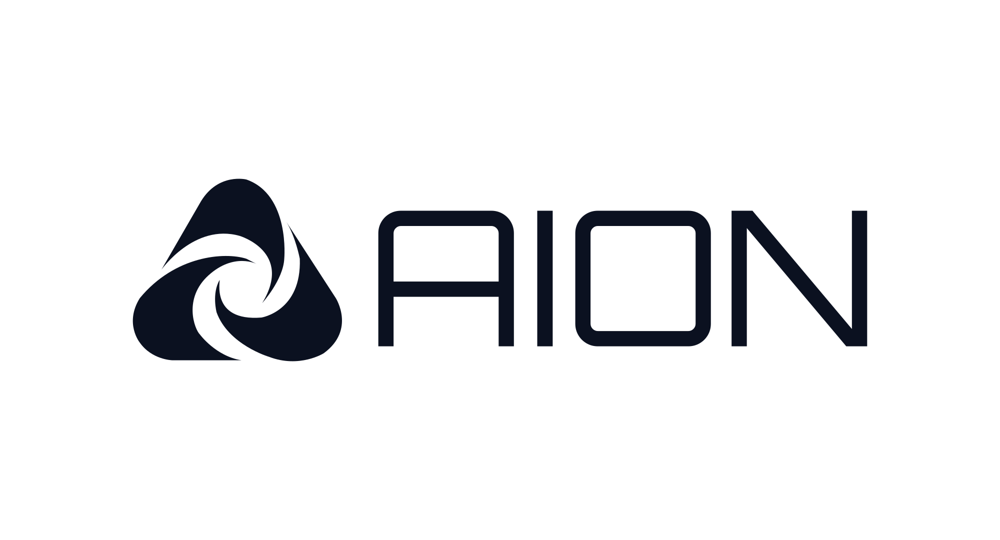

<div align="center">
  <br />
  <picture>
    <source media="(prefers-color-scheme: dark)" srcset="public/brand/titlelogo-light.svg" />
    <source media="(prefers-color-scheme: light)" srcset="public/brand/titlelogo-dark.svg" />
    
  </picture>
  <br /><br />
  <h3>Autonomous Interactive Operations Node</h3>
  <p>
    <strong>One calm, zero-bloat command center linking your PC, laptop, and phone.</strong><br />
    Hardware control, Wake-on-LAN, live media &amp; audio deck, and local-first device sync — running under 50 MB of RAM with zero external runtime dependencies.
  </p>
  <br />
  <p>
    <a href="https://github.com/aawal-code/AION/releases">
      
    </a>
    
    
    
    <a href="LICENSE">
      
    </a>
  </p>
  <br />
</div>

---

## Why AION?

Most multi-device setups force you to juggle a remote desktop client, a separate file-transfer utility, a media remote, and half a dozen background daemons that eat gigabytes of RAM.

**AION** replaces all of them with a single self-hosted node built on pure OS primitives:
* **Local-First & Private:** Talks directly over your local Wi-Fi/Ethernet subnet first, falling back seamlessly to your private Tailscale mesh when you're away. No third-party cloud relays.
* **Native App Feel:** Launches as a dedicated standalone desktop window on Windows and Linux, and installs as a cache-busted Progressive Web App (PWA) on iOS and Android.
* **Zero-Trace Lifecycle:** Tracks everything it provisions in `install-manifest.json` — if you ever uninstall AION, it cleans up *only* what it installed and leaves your system untouched.

---

## Core Capabilities

| Module | What It Does |
| :--- | :--- |
| **Power & Hardware Control** | Auto-classifies desktops, laptops, and mobile nodes. Lock sessions, turn off displays without sleeping, sleep, shut down, and inspect or force-quit running apps. |
| **Wake-on-LAN Engine** | Audits OS network adapter WoL readiness and Windows Fast Startup flags, then wakes sleeping machines remotely via UDP Magic Packets. |
| **Live Media & Audio Deck** | Real-time **Now Playing** metadata and playback controls (WinRT GSMTC & MPRIS), master volume slider, Mute, and **Discord-style Deafen** (mutes output and mic simultaneously). |
| **LAN & Mesh Transfer** *(In Progress)* | Zero-internet clipboard sync, instant image paste, and drag-and-drop file beaming across devices on your subnet or Tailscale network. |
| **Smart Watchers & Assistant** *(In Progress)* | Background conditional rules (*"sleep when my download finishes"*) paired with a unified command bar featuring a local 0-token fast-path router. |
| **Adaptive Cockpit UI** | Split-pane Apple-grade interface built with `Manrope` & `Cairo` typography, 10 built-in themes + custom color pickers, and full **English**, **Arabic (RTL)**, and **German** support. |

---

## Architecture

```text
┌─────────────────────┐        Local LAN (Subnet)        ┌─────────────────────┐
│   iPhone / Laptop   │ ◄──────────────────────────────► │   Primary Desktop   │
│  (PWA / App Window) │        Tailscale Mesh (VPN)      │  (AION Node :5050)  │
└─────────────────────┘ ◄──────────────────────────────► └──────────┬──────────┘
                                                                    │
                                          ┌─────────────────────────┼─────────────────────────┐
                                          ▼                         ▼                         ▼
                                  [ Power & WoL ]          [ WinRT / CoreAudio ]     [ Process & Watchers ]
```

---

## Quick Start

### 1. Standalone Installers *(Recommended)*
No Node.js or Tailscale pre-installed? AION's installer checks your system, fetches a portable Node runtime and headless Tailscale only if missing, registers the background daemon, and adds a native desktop launcher.

* **Windows:** Download `AION-Setup.exe` from the [Releases](https://github.com/aawal-code/AION/releases) page and run it. Uninstall anytime via **Windows Settings → Installed Apps**.
* **Linux (Ubuntu / Debian / Mint / Arch / Fedora):**
  ```bash
  curl -fsSL https://raw.githubusercontent.com/aawal-code/AION/main/scripts/install.sh | bash
  ```

### 2. Run From Source
Requires **Node.js v20+**:

```bash
git clone https://github.com/aawal-code/AION.git
cd AION
npm start
```

Open `http://localhost:5050` on your desktop, or connect from your phone via `http://<your-lan-or-tailscale-ip>:5050` and tap **Share → Add to Home Screen** on iOS.

---

<div align="center">
  <br />
  <picture>
    <source media="(prefers-color-scheme: dark)" srcset="public/brand/icon-light.svg" />
    <source media="(prefers-color-scheme: light)" srcset="public/brand/icon-dark.svg" />
    
  </picture>
  <br /><br />
  <p>
    <strong>Engineered by <a href="https://github.com/aawal-code">Abdulaziz Awal</a></strong><br />
    <sub>Built from scratch with zero dependencies.</sub>
  </p>
</div>